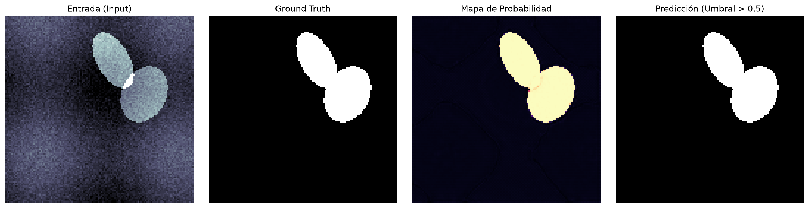

# U-Net para Segmentación Biomédica

Implementación limpia, autocontenida y sin sobreingeniería de la arquitectura **U-Net** (Ronneberger et al., 2015) en PyTorch, diseñada para comprender a fondo su funcionamiento teórico, sus decisiones de diseño y su relación con otras familias de redes neuronales en visión por computadora.

---

## Índice
1. [El Problema de la Segmentación Médica](#1-el-problema-de-la-segmentación-médica)
2. [Anatomía de la U-Net](#2-anatomía-de-la-u-net)
3. [El Rol Clave de las Skip Connections](#3-el-rol-clave-de-las-skip-connections)
4. [Relación con Arquitecturas Previas](#4-relación-con-arquitecturas-previas)
5. [¿Qué es "UUNet" ($U^2$-Net) y Otras Variantes?](#5-qué-es-uunet-u2-net-y-otras-variantes)
6. [Decisiones de Implementación en este Proyecto](#6-decisiones-de-implementación-en-este-proyecto)
7. [Estructura del Código](#7-estructura-del-código)
8. [Guía de Ejecución Rápida](#8-guía-de-ejecución-rápida)
9. [Batería de Pruebas Unitarias](#9-batería-de-pruebas-unitarias)
10. [Resultados y Métricas del Modelo](#10-resultados-y-métricas-del-modelo)

---

## 1. El Problema de la Segmentación Médica

En visión computacional tradicional y procesamiento de imágenes médicas existen diferentes niveles de tarea:

```
[Clasificación]       -> "¿Hay un tumor en esta resonancia?"          -> 1 etiqueta global
[Detección]           -> "¿Dónde está aproximadamente el tumor?"       -> Bounding Box (caja delimitadora)
[Segmentación Semántica]-> "¿Qué píxeles exactos pertenecen al tumor?" -> Máscara binaria píxel a píxel
```

En aplicaciones biomédicas (microscopía celular, resonancia magnética, tomografía computarizada), la **segmentación semántica** es la más exigente y crítica:
* **Escasez de datos anotados:** Etiquetar imágenes médicas a nivel de píxel requiere especialistas clínicos (patólogos o radiólogos), lo cual es costoso y lento. No se cuenta con millones de imágenes como en ImageNet.
* **Preservación de bordes milimétricos:** Conocer el volumen y límite exacto de una lesión celular o masa tumoral define un diagnóstico o margen quirúrgico.
* **Desbalance severo de clases:** Típicamente, más del 95% de los píxeles de una toma corresponden a tejido sano o fondo; la lesión suele ocupar entre el 1% y el 5% del área total.

La U-Net fue concebida en 2015 en la Universidad de Friburgo específicamente para resolver estas restricciones con pocos datos de entrenamiento.

---

## 2. Anatomía de la U-Net

La red debe su nombre a su diagrama simétrico en forma de **"U"**. Consta de tres componentes principales:

```
Entrada (H x W x C)
    │
    ▼
[ Contracting Path ]  ════ (Skip Connections) ════>  [ Expanding Path ]
(Encoder / Análisis)                                 (Decoder / Síntesis)
    │                                                        ▲
    └──────────────> [ Bottleneck ] ─────────────────────────┘
                   (Representación Latente)
                                                             │
                                                             ▼
                                                    Salida (H x W x Clases)
```

### A. Contracting Path (Encoder / Ruta de Contracción)
* **Objetivo:** Responder a la pregunta **¿Qué hay en la imagen?** (captura de contexto semántico).
* **Mecanismo:** Bloques convolucionales repetidos (`Conv2d -> BatchNorm -> ReLU -> Conv2d -> BatchNorm -> ReLU`) seguidos de un submuestreo espacial con `MaxPool2d(2x2, stride=2)`.
* **Transformación:** En cada nivel, la resolución espacial se divide a la mitad ($H/2, W/2$) y la cantidad de canales se duplica ($C \to 2C$). A mayor profundidad, los filtros detectan conceptos de mayor abstracción (texturas complejas, patrones morfológicos).

### B. Bottleneck (Cuello de Botella)
* Es la capa más profunda de la red.
* Contiene la menor resolución espacial y el mayor número de canales (e.g. 512 o 1024).
* Actúa como representación latente compacta de las características globales de la imagen.

### C. Expanding Path (Decoder / Ruta de Expansión)
* **Objetivo:** Responder a la pregunta **¿Dónde están ubicadas exactamente esas estructuras?** (localización precisa).
* **Mecanismo:** En cada nivel se aplica un sobremuestreo espacial (`ConvTranspose2d` o interpolación bilineal) que duplica la resolución ($2H, 2W$) y reduce a la mitad los canales.
* Los mapas resultantes se concatenan con los mapas equivalentes del encoder mediante las **Skip Connections**, y luego pasan por otro bloque de doble convolución.
* **Capa Final:** Una convolución $1 \times 1$ proyecta la cantidad de canales al número deseado de clases (en segmentación binaria, 1 canal de logits).

---

## 3. El Rol Clave de las Skip Connections

Las **conexiones de salto** son el núcleo conceptual que diferencia a la U-Net de un autoencoder convencional.

### ¿Qué problema resuelven?
Cuando una imagen atraviesa sucesivas capas de convolución y pooling:
1. El campo receptivo se agranda (la red ve el contexto general).
2. Pero **se destruye la información espacial de alta frecuencia** (bordes delgados, gradientes finos, posición exacta de cada píxel).

Al intentar reconstruir la imagen en el decoder, el cuello de botella por sí solo no tiene memoria de las coordenadas precisas donde estaban esos bordes en la imagen original; solo tiene información semántica de bajo nivel espacial.

### ¿Cómo lo resuelven?
Las skip connections toman los mapas de activación del encoder en cada nivel (que conservan intacta la resolución espacial alta antes del pooling) y los **concatenan por canales** (`torch.cat`) con los mapas upsampled del decoder:

```
Encoder Nivel 2:  Tensor de tamaño [B, 128, H/2, W/2]  ───┐
                                                          ├─► Concatenación: [B, 256, H/2, W/2]
Decoder Nivel 2:  Tensor upsampled [B, 128, H/2, W/2] ───┘
```

De esta forma, la convolución siguiente tiene acceso simultáneo a:
* La información semántica y contextual que sube desde el fondo de la red.
* La información geométrica y de localización exacta que viene horizontalmente del encoder.

> **Diferencia con ResNet:** En ResNet (He et al., 2015), las conexiones residuales realizan una **suma elemento a elemento** ($x + F(x)$) para facilitar el gradiente en redes ultra-profundas. En U-Net se realiza una **concatenación de canales**, permitiendo que las capas subsiguientes combinen libremente características espaciales y semánticas con pesos aprendidos.

---

## 4. Relación con Arquitecturas Previas

Para contextualizar la U-Net frente a lo que habitualmente se estudia en visión artificial:

| Arquitectura | Salida Principal | Limitación Principal | Relación con U-Net |
| :--- | :--- | :--- | :--- |
| **CNNs Clásicas**<br>*(LeNet, AlexNet, VGG, ResNet)* | Vector 1D de probabilidades (Clasificación global). | Pierden la matriz 2D al pasar por capas lineales (`Flatten` / `Linear`). Dicen qué hay, pero no dónde. | U-Net hereda las capas convolucionales del encoder, pero elimina por completo las capas densas/fully-connected. |
| **Autoencoders Clásicos**<br>*(Convolucionales / VAE)* | Imagen reconstruida ($H \times W \times C$). | Toda la información debe cruzar obligatoriamente el cuello de botella latente. Generan bordes borrosos. | U-Net tiene la misma silueta encoder-decoder, pero añade las skip connections para evitar la pérdida de definición en el cuello de botella. |
| **FCN**<br>*(Fully Convolutional Networks, 2015)* | Mapa de segmentación denso ($H \times W$). | Usaban sumas dispersas (FCN-8s/16s/32s) sobre backbones de clasificación (VGG). La reconstrucción de bordes era tosca. | U-Net formaliza un decoder simétrico completo y sustituye la suma por concatenación directa multiescala. |

---

## 5. ¿Qué es "UUNet" ($U^2$-Net) y Otras Variantes?

En la literatura de visión artificial es común encontrar términos relacionados:

1. **U-Net Original (2015):** La arquitectura descrita aquí, estándar indiscutido en imagen médica.
2. **$U^2$-Net ($U$-Square Net, Qin et al., 2020):** 
   * Es una arquitectura de dos niveles anidados ("U-Net dentro de U-Net").
   * En lugar de bloques convolucionales planos, utiliza bloques llamados **RSU (ReSidual U-blocks)** que contienen una pequeña U-Net interna.
   * Permite capturar características contextuales a múltiples escalas sin sacrificar resolución, muy popular en tareas como *Salient Object Detection* (detección de objetos prominentes o recorte de siluetas).
3. **UNet++ (Zhou et al., 2018):** 
   * Rediseña las skip connections sustituyendo la conexión horizontal directa por una densa malla de sub-redes convolucionales anidadas, reduciendo la brecha semántica entre encoder y decoder.
4. **Attention U-Net (Oktay et al., 2018):**
   * Agrega compuertas de atención (*Attention Gates*) en las skip connections para atenuar regiones irrelevantes del fondo y focalizar los gradientes en la lesión diana.

---

## 6. Decisiones de Implementación en este Proyecto

### A. Padding en las Convoluciones (`padding=1` vs `padding=0`)
* **En el paper original (2015):** Utilizaban convoluciones sin relleno (*valid padding*, `padding=0`). Esto provocaba que cada convolución $3 \times 3$ redujera la imagen en 2 píxeles por lado, requiriendo un recorte central (*center crop*) de los mapas del encoder antes de concatenarlos y produciendo una salida menor que la entrada (e.g. entrada $572 \times 572 \to$ salida $388 \times 388$).
* **En nuestra implementación moderna:** Usamos convoluciones con relleno constante (`padding=1`), logrando que las dimensiones espaciales coincidan exactamente ($H_{out} = H_{in}$). Esto simplifica drásticamente el pipeline, elimina la pérdida de bordes por recorte y permite procesar imágenes de cualquier resolución divisible por 16 o 32.

### B. Muestreo Ascendente (`ConvTranspose2d` con soporte Bilinear)
* Por defecto se utiliza convolución transpuesta aprendible (`kernel_size=2, stride=2`), que aprende a descompactar la información espacial durante el entrenamiento.
* Se incluye el parámetro `bilinear=True` como alternativa libre de artefactos de tablero (*checkerboard artifacts*).

### C. Función de Pérdida Combinada (BCE + Dice)
En segmentación médica, el error estándar de entropía cruzada no es suficiente:

$$\mathcal{L}_{\text{BCE}} = -\frac{1}{N}\sum \left[ y \log(\hat{y}) + (1-y)\log(1-\hat{y}) \right]$$

$$\text{Dice} = \frac{2 |Y \cap \hat{Y}| + \epsilon}{|Y| + |\hat{Y}| + \epsilon}, \quad \mathcal{L}_{\text{Dice}} = 1 - \text{Dice}$$

$$\mathcal{L}_{\text{Total}} = 0.5 \cdot \mathcal{L}_{\text{BCE}} + 0.5 \cdot \mathcal{L}_{\text{Dice}}$$

* **¿Por qué combinarlas?** 
  * BCE provee gradientes suaves y estables en etapas tempranas de convergencia a nivel de píxel.
  * Dice Loss evalúa directamente el solapamiento global de las regiones segmentadas e inmune al desbalance entre fondo y lesión.

---

## 7. Estructura del Código

El repositorio está organizado deliberadamente de forma compacta y legible:

```
UNetSandbox/
├── model.py            # Definición limpia de DoubleConv, Down, Up y UNet en PyTorch
├── dataset.py          # Generador biomédico sintético (células/lesiones) y cargador de carpetas reales
├── train.py            # Bucle de entrenamiento, DiceLoss, BCEDiceLoss y cálculo de IoU
├── predict.py          # Inferencia, métricas de prueba y generación visual comparativa
├── test_unet.py        # Suite de pruebas unitarias (shapes, gradientes, límites de loss)
└── README.md           # Este documento de referencia conceptual y metodológica
```

---

## 8. Guía de Ejecución Rápida

El proyecto es **100% reproducible y autocontenido**: incluye un generador sintético que simula imágenes celulares y gradientes de atenuación, por lo que no es obligatorio descargar datasets externos para probarlo.

### 1. Ejecutar las Pruebas Unitarias
Valida la integridad de las dimensiones de los tensores, el flujo de gradientes hacia atrás y los límites de la función de pérdida:
```bash
python3 test_unet.py
```

### 2. Entrenar el Modelo
Entrena la red durante 10 épocas guardando el mejor checkpoint en `checkpoints/best_model.pth`:
```bash
python3 train.py --epochs 10 --batch-size 8 --lr 0.001
```

### 3. Ejecutar Inferencia y Ver Resultados
Carga el modelo entrenado y genera una visualización en 4 paneles (`prediction_sample.png`) comparando:
* Entrada original
* Máscara real (*Ground Truth*)
* Mapa continuo de probabilidades
* Predicción binaria umbralizada

```bash
python3 predict.py --checkpoint checkpoints/best_model.pth --output prediction_sample.png
```

### 4. Uso con Datos Médicos Propios (Opcional)
Si querés evaluar la red con datos reales (como ISIC, DRIVE o EM Segmentation), organizá tu carpeta de la siguiente forma:

```
data/
├── train/
│   ├── images/   (e.g. img001.png, img002.png)
│   └── masks/    (e.g. img001.png, img002.png con valores 0 o 255)
└── val/
    ├── images/
    └── masks/
```

Y ejecutá:
```bash
python3 train.py --data-dir data/ --epochs 30
```

---

## 9. Batería de Pruebas Unitarias

El archivo `test_unet.py` implementa una suite rigurosa construida con `unittest` para verificar el correcto funcionamiento arquitectónico, matemático y de flujos de datos antes de entrenar:

```bash
python3 test_unet.py
```

### Casos de Prueba Cubiertos

| Test | Objetivo | Criterio de Aceptación |
| :--- | :--- | :--- |
| `test_forward_shape_standard` | Consistencia dimensional estándar | Un tensor de entrada `(2, 1, 128, 128)` genera una salida con idénticas dimensiones espaciales `(2, 1, 128, 128)`. |
| `test_forward_shape_arbitrary` | Robustez ante resoluciones asimétricas | Evalúa tensores con dimensiones no divisibles exactamente por 32 (e.g. `130 x 130`), comprobando que el padding dinámico en el módulo `Up` compense asimetrías al concatenar skip connections. |
| `test_gradient_flow` | Integridad de retropropagación (backprop) | Ejecuta un pase hacia adelante y hacia atrás con `BCEDiceLoss`, verificando que **ningún parámetro entrenable** tenga gradiente nulo (`param.grad is not None`). |
| `test_dice_loss_bounds` | Comportamiento asintótico de la función de pérdida | Evalúa los límites matemáticos de `DiceLoss`: con logits muy altos (predicción perfecta) el loss tiende a $0$ ($< 0.05$); con logits muy negativos (falla total) tiende a $1$ ($> 0.95$). |
| `test_synthetic_dataset` | Integridad del generador de datos | Verifica que las muestras sintéticas tengan la forma esperada, que los valores de imagen estén acotados en $[0.0, 1.0]$ y que las máscaras contengan únicamente valores binarios $\{0.0, 1.0\}$. |

### Salida de Ejecución
```text
.....
----------------------------------------------------------------------
Ran 5 tests in 1.292s

OK
```

---

## 10. Resultados y Métricas del Modelo

### A. Rendimiento del Checkpoint Actual (`checkpoints/best_model.pth`)

El modelo provisto en el repositorio fue entrenado durante 15 épocas utilizando el optimizador `AdamW` ($\text{lr} = 10^{-3}$, $\text{weight decay} = 10^{-4}$) y un programador de tasa de aprendizaje por recocido cosenoidal (`CosineAnnealingLR`). 

Los pesos guardados corresponden a la época con mejor rendimiento en validación:

| Parámetro / Métrica | Valor Obtenido | Descripción |
| :--- | :--- | :--- |
| **Época del Checkpoint** | `8` / `15` | Momento en el que se alcanzó la mejor convergencia antes del plateau. |
| **Validation Dice Score** | **`0.9999` (99.98%)** | Coeficiente de similitud de Sørensen-Dice (solapamiento entre predicción y ground truth). |
| **Validation IoU (Jaccard)** | **`0.9998` (99.97%)** | Índice de Intersección sobre Unión ($|A \cap B| / |A \cup B|$). |
| **Función de Pérdida** | $\mathcal{L}_{\text{BCE+Dice}} \approx 0.0002$ | Combinación balanceada ($0.5 \cdot \text{BCE} + 0.5 \cdot \text{Dice}$). |

> **Nota Metodológica sobre los Resultados:**
> Las métricas cercanas al 100% se deben a que el entrenamiento se llevó a cabo sobre el benchmark sintético (`SyntheticMedicalDataset`), donde las estructuras target son formas elípticas con ruido gaussiano parametrizado. Este benchmark demuestra que el flujo de gradientes, la capacidad de localización y las skip connections funcionan de forma óptima. En datasets clínicos reales (por ejemplo, ISIC o BraTS), un Dice Score representativo del estado del arte suele situarse entre `0.78` y `0.92`, dependiendo de la complejidad y el contraste de la patología.

### B. Inferencia Visual (`prediction_sample.png`)

La ejecución de `predict.py` genera un panel comparativo con 4 etapas de inferencia:



1. **Entrada (Input):** Imagen médica sintética en escala de grises con fondo no homogéneo y gradiente de atenuación.
2. **Máscara Real (Ground Truth):** Localización y forma exacta de las estructuras celulares objetivo.
3. **Probabilidad (Sigmoid):** Mapa continuo $\in [0, 1]$ que refleja la certidumbre de la red en cada coordenada espacial.
4. **Predicción (Threshold > 0.5):** Máscara binaria final resultante tras aplicar el umbral de decisión, mostrando la delimitación nítida de los bordes gracias a las skip connections.
